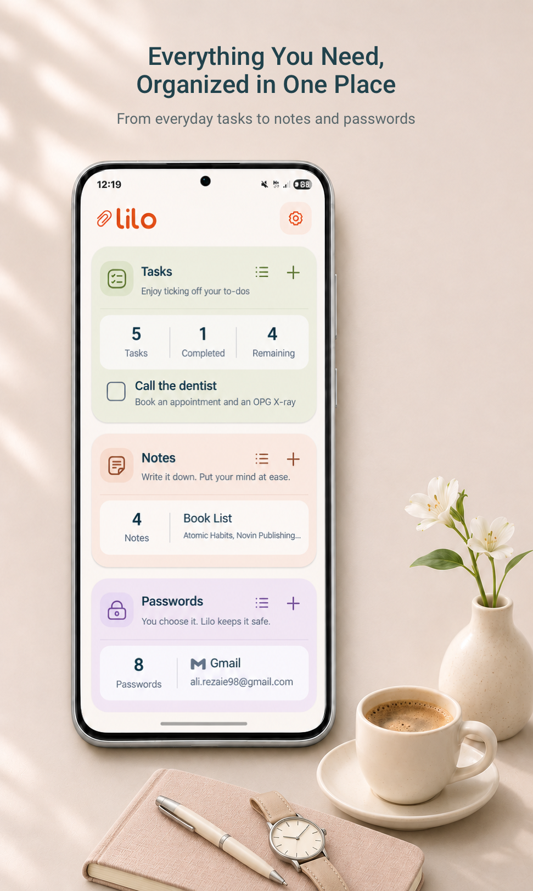
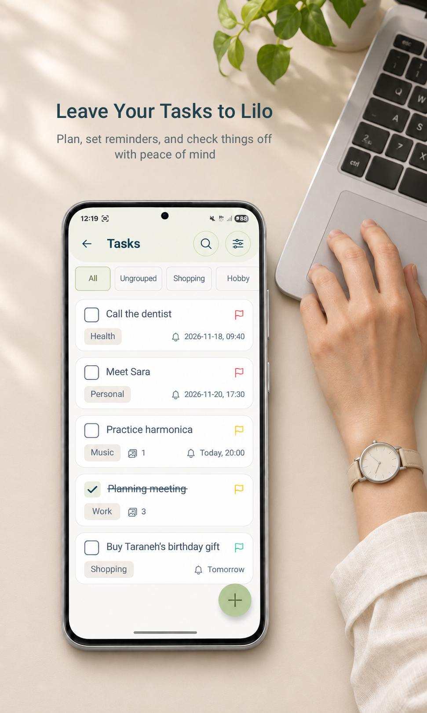
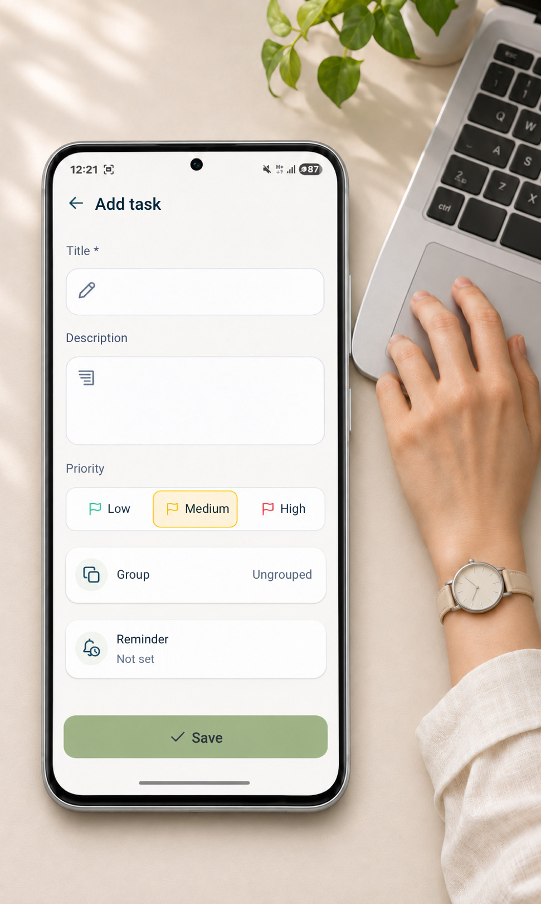
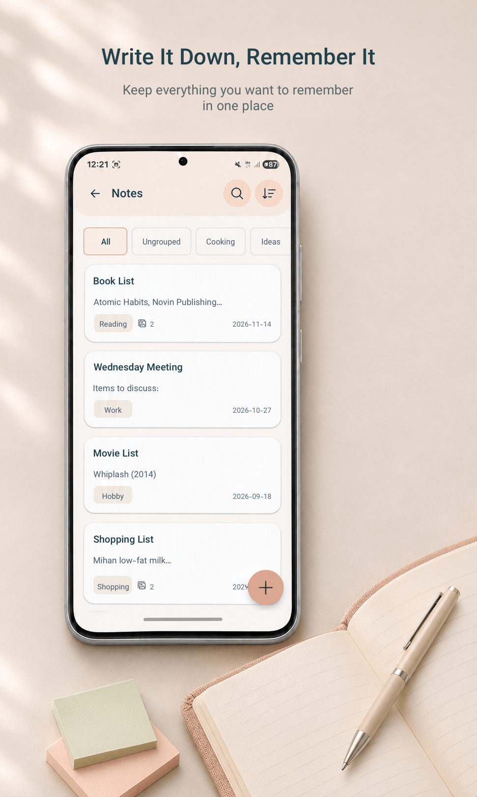
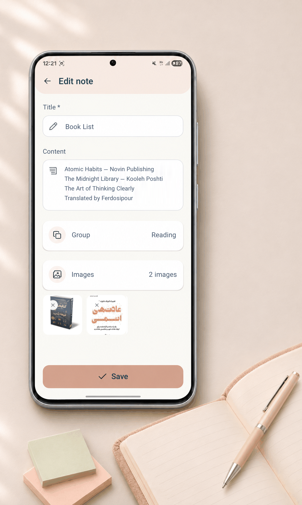
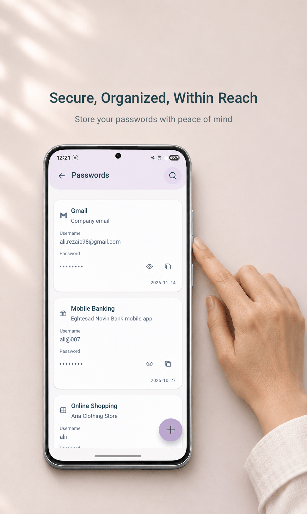
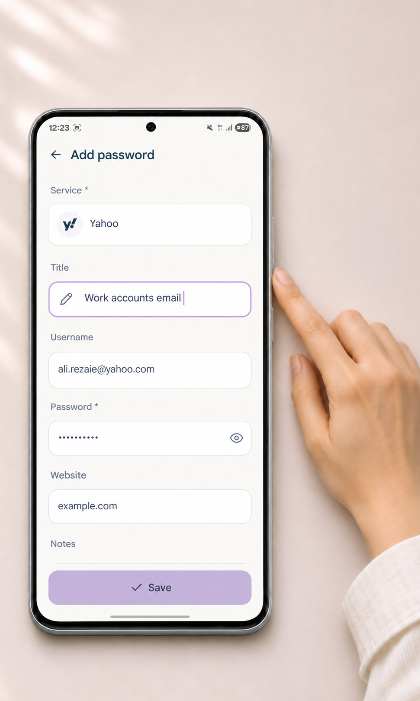
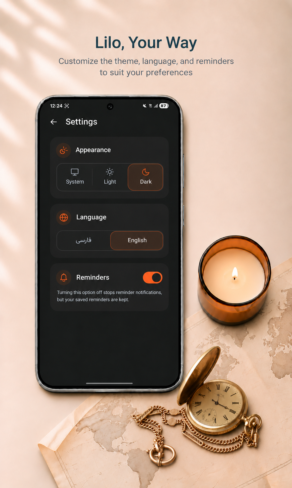

# Lilo · لیلو

Lilo is a Kotlin Multiplatform personal organizer for Android and iOS. It brings tasks, notes, and passwords into a simple, consistent app with local storage and support for English and Persian.

## Features

- **Home:** Recent-item previews, summaries, and quick access to everyday actions.
- **Tasks:** Groups, priorities, completion tracking, search and filters, recurring reminders, and image attachments.
- **Notes:** Create and edit grouped notes with images, search, and sorting.
- **Passwords:** Organize credentials by service, with encrypted password values and device authentication for access.
- **Settings:** Light, dark, and system themes; English/LTR and Persian/RTL layouts; reminder preferences.

## Architecture

Lilo follows Clean Architecture principles with feature-based organization and separation of domain, data, and presentation responsibilities. MVI-style unidirectional state flow keeps UI state predictable. UI and business logic are shared across platforms, with native integrations for device capabilities.

## Used Technologies

- **Kotlin Multiplatform:** Shared application logic for Android and iOS.
- **Compose Multiplatform & Material 3:** Declarative UI and consistent styling.
- **Coroutines & Flow:** Asynchronous work and reactive state.
- **Koin:** Dependency injection.
- **Room Multiplatform & SQLite:** Local structured storage.
- **DataStore:** Persistent user preferences.
- **Navigation Compose:** Screen navigation.
- **Kotlin Serialization & kotlinx-datetime:** Serialization and date/time handling.
- **Firebase:** Analytics, crash reporting integration, and Android messaging.

## Screenshots

## Screenshots

<table>
  <tr>
    <td align="center">
      
       Home
    </td>
    <td align="center">
      
       Tasks
    </td>
    <td align="center">
      
       Task Form
    </td>
    <td align="center">
      
       Notes
    </td>
  </tr>
  <tr>
    <td align="center">
      
       Note Form
    </td>
    <td align="center">
      
       Passwords
    </td>
    <td align="center">
      
       Password Form
    </td>
    <td align="center">
      
       Settings
    </td>
  </tr>
</table>

